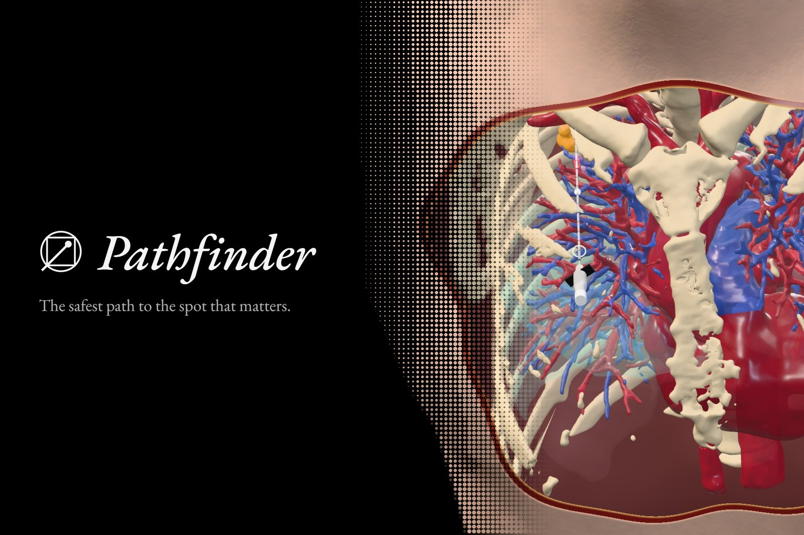
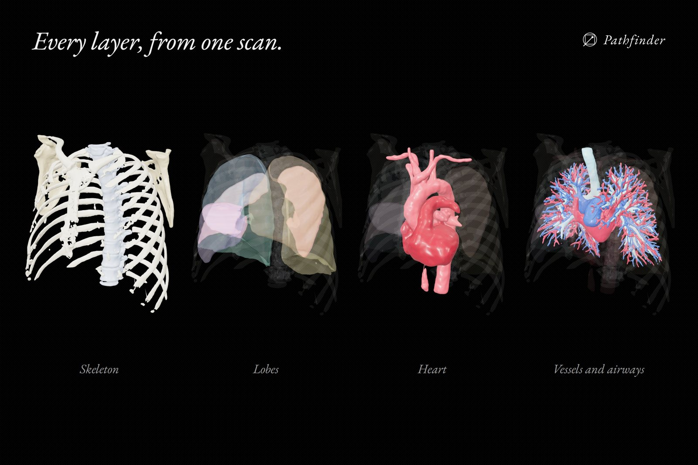
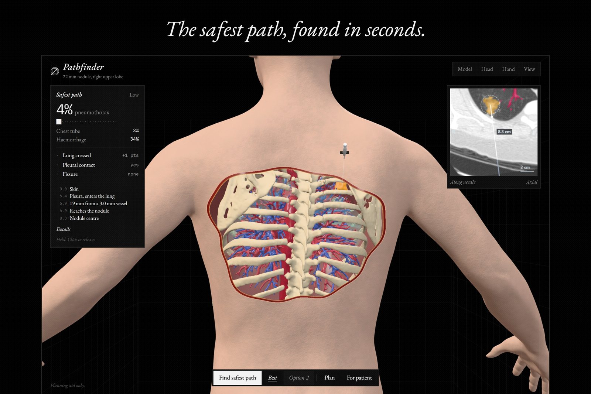

<p align="center">
  <picture>
    <source media="(prefers-color-scheme: dark)" srcset="docs/media/logo-dark-mode.svg">
    
  </picture>
</p>

<p align="center">
  <b>See through. Biopsy safer.</b><br>
  3D planning for CT-guided lung biopsies. Built at Hack Western 13.
</p>

<p align="center">
  
</p>

## What it is

About 1 in 4 patients who get a CT-guided lung biopsy end up with a collapsed lung. The biggest thing the doctor
controls is the needle's path, and today it's chosen by eye, scrolling through flat CT slices.

Pathfinder turns the patient's own CT into a 3D model you can look into like a window: move your head and the view
moves with you. Aim the needle with your hand (or mouse), and every path shows what it hits, how close it gets to
vessels, and its risk of a collapsed lung, chest tube and bleeding, from published studies. One click finds the
safest path. Gemini then explains the plan to the doctor and to the patient, in the patient's own language.

> Research prototype and decision support only. Not a medical device.

## How it works

```
CT scan ─► Pipeline (TotalSegmentator) ─► 3D anatomy model ─► Planner (aim + risk) ─► Gemini (explain)
```

1. **Pipeline (Python).** TotalSegmentator segments and labels the CT: lobes, arteries, veins, airways, ribs,
   spine, heart. We refine edges with tissue density, find the nodule, precompute distance maps to every vessel
   and fissure, and build the meshes inside a full body fitted to the patient.
2. **Planner (browser).** Three.js renders the body with a window cut into the chest; MediaPipe tracks your head
   (off-axis "window" projection) and hand (pinch to aim, release to hold). The risk engine traces each path
   through the patient's volumes in milliseconds and scores it; the planner searches thousands of entries for the
   safest. Everything runs locally: no patient data leaves the device.
3. **Gemini (FastAPI).** Turns the computed plan into a doctor's procedure plan and a plain-language patient
   explanation with Q&A and read-aloud. Our code computes every number; Gemini only explains them.

<p align="center">
  
  
</p>

## Run it

```bash
# Python (pipeline + API)
py -3.12 -m venv .venv
.venv/Scripts/python -m pip install -r requirements.txt

# Web
cd web && npm install && cd ..

# Demo case (only if web/public/cases/lidc-0742 is missing; ~15 min on CPU)
.venv/Scripts/python pipeline/fetch_case.py     # public LIDC-IDRI chest CT
.venv/Scripts/python pipeline/segment.py        # TotalSegmentator
.venv/Scripts/python pipeline/build_case.py     # → web/public/cases/lidc-0742/

# Gemini key (optional; without it the explanations fall back to templates)
cp .env.example .env                             # then set GEMINI_API_KEY

# Start
.venv/Scripts/python -m uvicorn server.app:app --port 8000
cd web && npm run dev                            # site at :5173, planner at :5173/planner
```

| Do | How |
|---|---|
| Aim / hold a path | Hover and click, or turn on **Hand** and pinch to aim, release to hold |
| Look around | Turn on **Head**, or use the arrow keys |
| Turn the patient | Right-drag, **View** menu, or keys `1`–`4` |
| Safest path | **Find safest path** |
| Explanations | **Plan** (doctor) and **For patient** |

## The risk model

`pathAnalysis.ts` marches along the needle through the label volumes and measures what the literature says
matters: lung crossed, fissures, emphysema and bullae, pleural angle, vessel distance and calibre, and hard
blockers (bone, heart, great vessels). `riskModel.ts` turns those into probabilities with logistic models built
from published odds ratios and calibrated to pooled rates. Every coefficient and its source is in
[docs/risk-evidence.md](docs/risk-evidence.md); how far to trust the AI anatomy, and the safety margins we apply
for it, is in [docs/segmentation-confidence.md](docs/segmentation-confidence.md).

## Built with

TypeScript · React · Three.js · MediaPipe · Python · TotalSegmentator · NumPy / SciPy · scikit-image · trimesh ·
FastAPI · Gemini API · Vite

## Credits

Built by Eric Fu, Ibrahim Farrukh and Shourya Walia at Hack Western 13.

CT data: LIDC-IDRI (Armato et al., Med Phys 2011) via The Cancer Imaging Archive, CC BY 3.0; nodule positions from
LUNA16. Segmentation: TotalSegmentator (Wasserthal et al., Radiol AI 2023). Body model: MakeHuman (CC0).
